# Install SoduWork and Start Your First Conversation

[简体中文](desktop-quickstart.md) · **English** · [Documentation](README.md)

> **Summary**: This guide explains how to download and install the SoduWork desktop client, connect to a SoduWork service, register an account, and start your first conversation. This guide covers the desktop client only; if you plan to self-host the backend Hub service, see [Docker self-hosting](../ops/self-host/README.md). To run from source, see [Run from source](getting-started.en.md).

> Screenshots illustrate the steps and may show older versions such as 1.13.15. Download from the latest release linked below; use its asset names and the current UI. Screenshot versions, paths and commands are examples.

## 1. Overview & Prerequisites

- **What It Does**: An open-source, enterprise-grade AI-native collaboration desktop client.
- **Supported Systems**: Windows 10 / 11, Linux (such as Ubuntu), and macOS (Apple Silicon and Intel).
- **Recommended Disk Space**: At least 20 GB of free disk space is recommended for installation and daily use.
- **Network & Account Preparation**: Ensure your network can access GitHub and your target SoduWork server. The default public service endpoint is `https://service.soduwork.ai`. If you are connecting to a self-hosted enterprise instance, obtain the Hub URL from your administrator in advance.

## 2. Download the Installer

1. **Open the Official Releases Page**: Visit the [latest SoduWork release](https://github.com/mdiri-ai/SoduWork/releases/latest).
2. **Expand Assets**: Under the latest stable release (usually tagged as `Latest`), click to expand the **Assets** section.
3. **Choose the Installer for Your OS**:
    - **Windows**: Select the `.exe` installer (for example, `SoduWork-<version>-Setup.exe`).
    - **Linux (Ubuntu example)**: Select the `.deb` package matching your system architecture (for example, `SoduWork-<version>-linux.deb`).
    - **macOS**: Select the **arm64** `.dmg` installer for Apple Silicon Macs (M1/M2/M3/M4), or the **x64** `.dmg` installer for older Intel-based Macs.
    - **Note**: `Source code (zip)`, `Source code (tar.gz)`, and Hub server image archives are not desktop installers and do not need to be downloaded by end users.

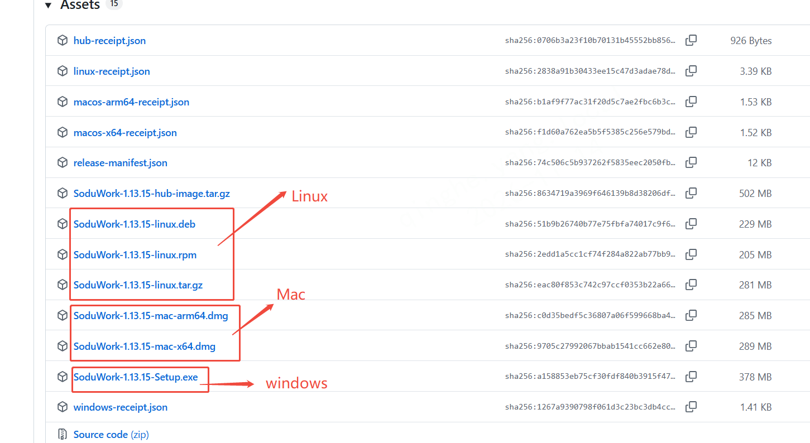

## 3. Step-by-Step Installation

### Windows

1. **Run the Installer**: Double-click the downloaded `.exe` file in your browser's download list or your **Downloads** folder. If User Account Control (UAC) prompts you for permission, click **Yes**.
2. **Select Installer Language**: Choose your preferred setup language and click **OK**.
3. **Choose Installation Scope & Destination**: Select whether to install for the current user only or for all users, confirm or customize the installation path, and click **Next** / **Install**.
4. **Finish & Launch**: Wait for the installation to complete, keep **Run SoduWork** checked (or launch it from the Desktop shortcut / Start Menu), and click **Finish**.

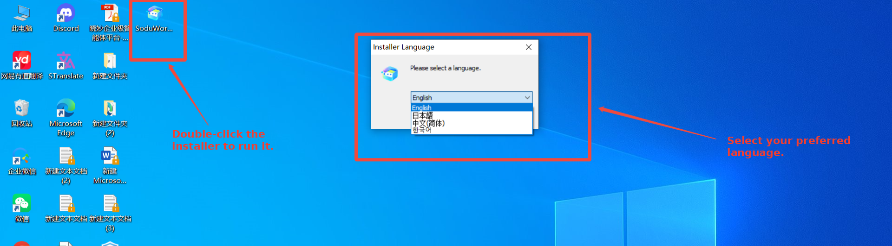

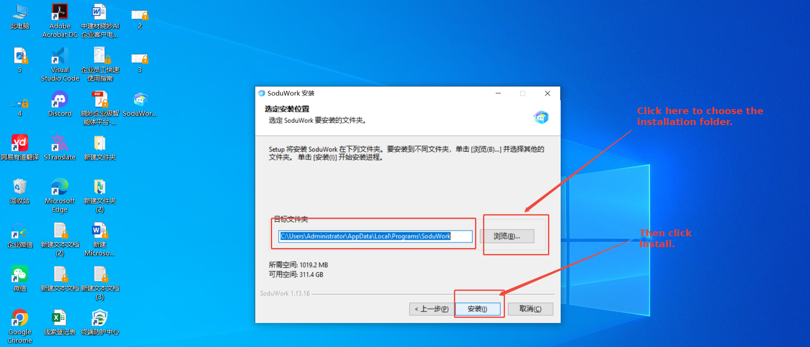

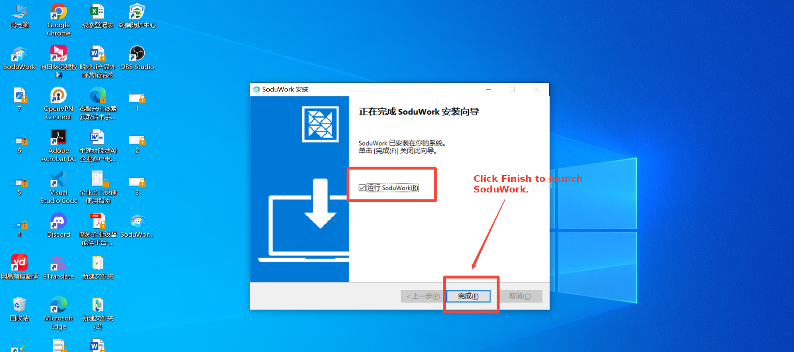

### Linux (Ubuntu / Debian)

1. **Locate the Downloaded Package**: Open a terminal, navigate to the folder containing the installer (typically `~/Downloads`), and check the exact `.deb` filename:
   ```bash
   cd ~/Downloads
   ls -lh SoduWork*.deb
   ```
2. **Install the Local Package with `apt`**: Run the following commands (replace `<actual-filename>.deb` with the filename from the previous step; the `./` prefix ensures `apt` treats it as a local file and resolves dependencies):
   ```bash
   sudo apt update
   sudo apt install ./<actual-filename>.deb
   ```
3. **Launch the Client**: Search for **SoduWork** in your system application menu, or run `soduwork` directly from the terminal.

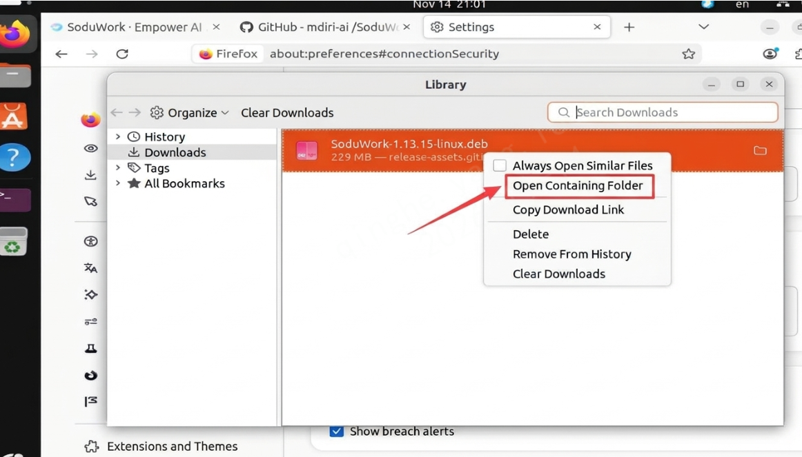

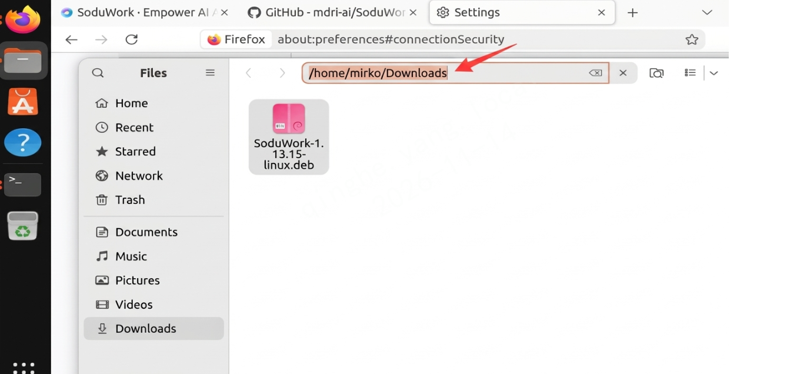


### macOS

Locate the downloaded `.dmg` installer (for example, `SoduWork-<version>-mac-arm64.dmg`) in your **Downloads** folder and follow these 3 steps:

1. **Mount the Disk Image**: Double-click the `.dmg` file and wait for macOS to verify it and open the installer window.
2. **Drag to Applications**: Drag the `SoduWork` icon into the **Applications** folder on the right.
3. **Launch from Applications**: Open **Finder → Applications** and double-click **SoduWork**. If macOS displays a security warning on first launch, refer to the macOS section under **Troubleshooting & Tips** below.

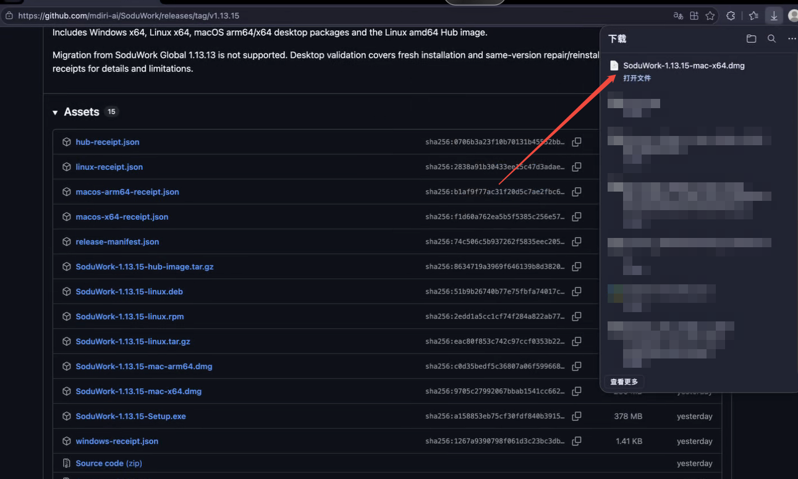

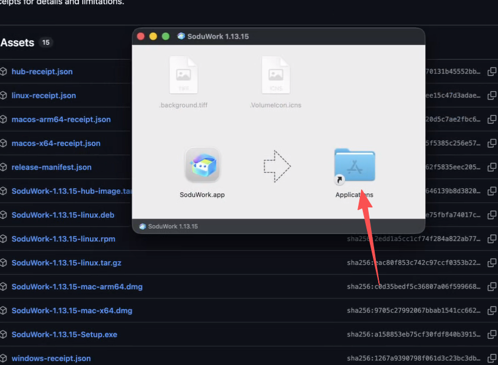

## 4. Sign Up & Start Your First Conversation

1. **Switch Language & Verify Server Endpoint**:
    - You can change the display language using the language selector at the bottom of the login screen.
    - Before signing in or creating an account, verify the **Server Connection** address: confirm it is set to `https://service.soduwork.ai` for the public service, or enter the Hub URL provided by your administrator for a self-hosted deployment.
2. **Sign In or Create an Account**:
    - If you already have an account, enter your email and password to sign in.
    - For first-time users, click **Create Account** in the bottom-left corner, enter your email, click **Get Verification Code**, enter the code sent to your inbox, set a password that meets the on-screen requirements (8–128 characters by default), confirm the password, check the boxes for **User Agreement** and **Privacy Policy**, and submit.

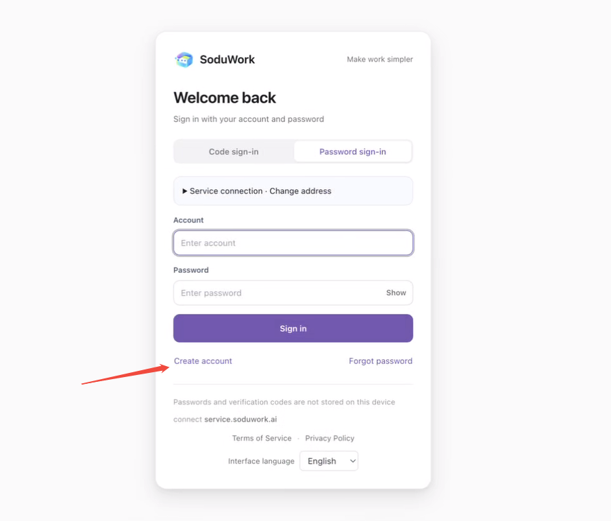

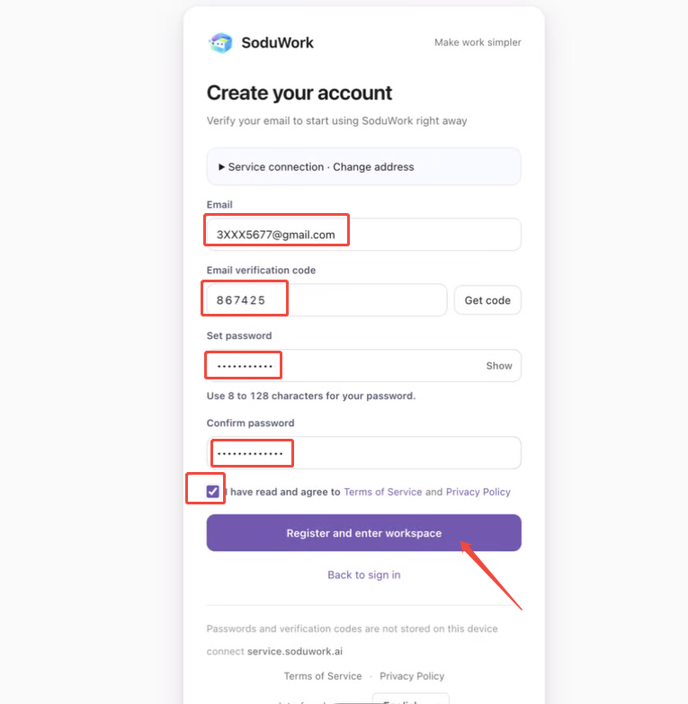

3. **Enter the Workspace & Start Your First Conversation**:
    - After signing in, the main workspace opens.
    - Click **New Chat**, then select an available **Agent** and **Model** from the conversation settings.
    - Send a quick test prompt, such as: `Summarize the following mock meeting notes into action items: Alex will finish API integration by Wednesday, and Sam will deliver the QA report by Friday.`
    - Receiving a valid response confirms your client is properly connected to the backend service. If the Agent or Model list is empty, double-check your server connection URL or contact your environment administrator to verify permissions and model configurations.

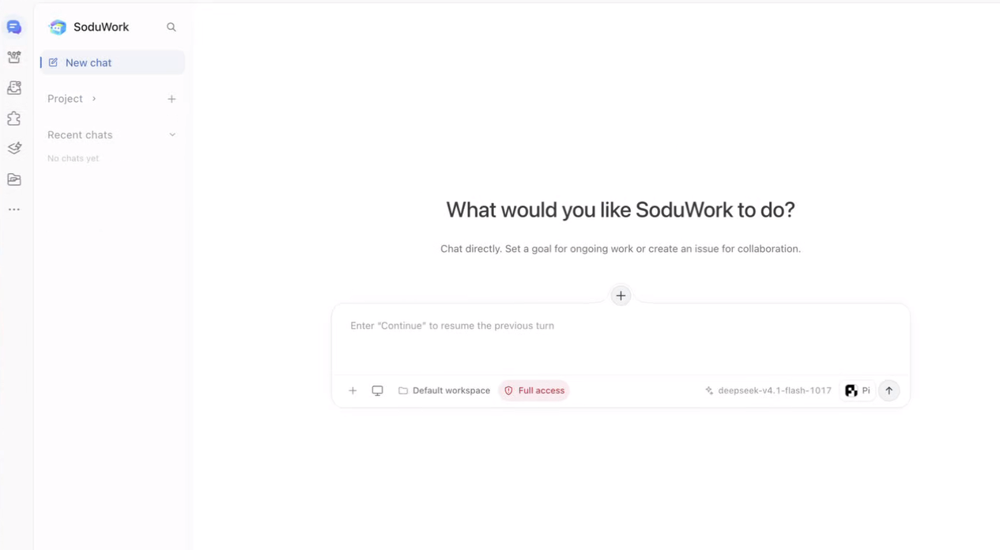

## 5. Troubleshooting & Tips

### 1. macOS Security Warning ("Cannot Be Opened")

- **Verify the Source**: Ensure you downloaded the installer directly from the official [GitHub Releases](https://github.com/mdiri-ai/SoduWork/releases/latest) page. Never bypass security warnings for unverified files.
- **Allow the App to Run**: If macOS blocks the app because Apple cannot check it for malicious software, open **System Settings → Privacy & Security**, scroll down to the `SoduWork` notice, click **Open Anyway**, and enter your administrator password to confirm.
- **Official Reference**: Instructions vary slightly across macOS versions. See [Apple Support: Safely open apps on your Mac](https://support.apple.com/en-us/102445) for full details.

### 2. Linux `.deb` Installation Errors

If `sudo apt install ./<actual-filename>.deb` fails, troubleshoot based on the exact error message rather than relying solely on `apt update` (which only refreshes package lists without fixing missing dependencies):

- **Unmet dependencies**: Run `sudo apt --fix-broken install` to install missing dependencies, then re-run `sudo apt install ./<actual-filename>.deb`.
- **File not found or permission denied**: Verify your current working directory in the terminal and make sure `./` precedes the filename (for example, `./SoduWork-<version>-linux.deb`).
- **Architecture mismatch**: Run `uname -m` to check your system architecture (`x86_64` corresponds to `amd64`; `aarch64` to `arm64`). Only install a package for your architecture if the release provides one.
- **Corrupted archive**: The download may be incomplete. Remove the damaged file and download it again from the latest GitHub release.
- **Official Reference**: See [Ubuntu package management](https://ubuntu.com/server/docs/how-to/software/package-management/).

### 3. Slow Downloads or Service Connection Failures

- **GitHub download failures**: Check your network access to GitHub.
- **DNS errors or connection timeouts**: Check the service URL (`https://service.soduwork.ai` or your enterprise Hub), including the `http://` or `https://` prefix.
- **Proxy configuration**: Configure a proxy only if your network requires one and your administrator has provided a valid address and port. Browser proxy settings do not generally configure the desktop client; use the system proxy or an administrator-approved global/TUN configuration when needed.

The following screenshots show Firefox proxy settings for browser downloads; they do not change the desktop client's proxy settings.

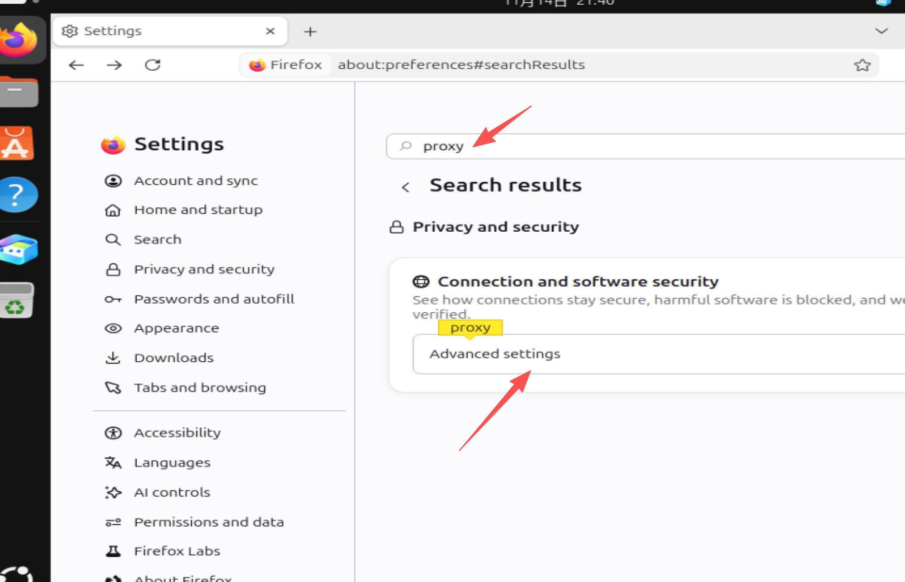

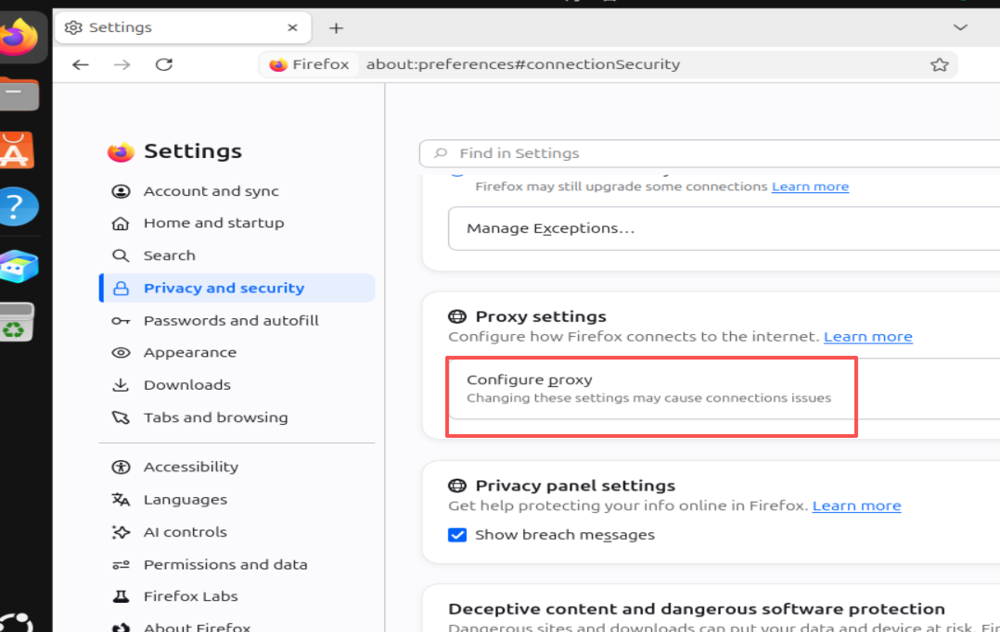

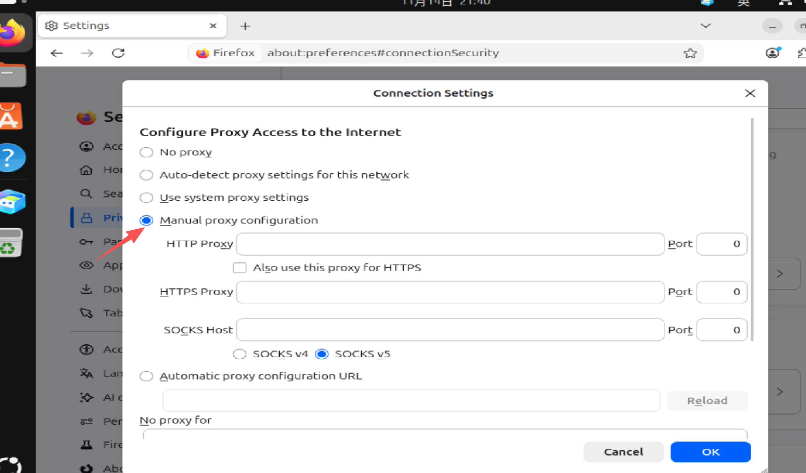
