# SoduWork 桌面客户端安装与首次使用

**简体中文** · [English](desktop-quickstart.en.md) · [文档导航](README.zh-CN.md)

> **摘要**：本文介绍如何下载、安装 SoduWork 桌面客户端，并连接 SoduWork 服务完成注册与首次对话。本文仅适用于桌面客户端安装；如需自行部署后端 Hub 服务，请查阅 [Docker 自托管指南](../ops/self-host/README.zh-CN.md)。从源码运行请参阅[从源码启动](getting-started.md)。

> 截图用于说明操作步骤，可能显示 1.13.15 等旧版本。请从下方最新发布页下载安装包，以实际资源文件名和当前界面为准；截图中的版本、路径和命令仅为示例。

## 一、软件简介与准备工作

- **软件用途**：开源的企业级 AI 原生协同平台桌面客户端。
- **支持系统**：Windows 10 / 11、Linux（如 Ubuntu）、macOS（Apple Silicon 芯片与 Intel 芯片）。
- **硬盘空间建议**：安装与后续使用建议预留至少 20 GB 可用硬盘空间。
- **网络与账号准备**：确认当前网络可访问 GitHub 与目标 SoduWork 服务地址；公共服务默认连接地址为 `https://service.soduwork.ai`，企业自建服务请提前向管理员获取 Hub 地址。

## 二、下载安装包

1. **打开官方发布页**：访问 [SoduWork GitHub Releases 页面](https://github.com/mdiri-ai/SoduWork/releases/latest)。
2. **展开资源列表**：在最新稳定版（通常标有 `Latest`）下方点击展开 **Assets** 列表。
3. **选择对应系统的桌面安装包**：
    - **Windows**：选择 `.exe` 安装程序（例如 `SoduWork-<version>-Setup.exe`）。
    - **Linux（以 Ubuntu 为例）**：选择与系统架构匹配的 `.deb` 安装包（例如 `SoduWork-<version>-linux.deb`）。
    - **macOS**：Apple Silicon（M1/M2/M3/M4）芯片选择 **arm64** 版本的 `.dmg` 安装包；老款 Intel 芯片选择 **x64** 版本的 `.dmg` 安装包。
    - **注意**：列表中的 `Source code (zip)`、`Source code (tar.gz)` 以及 Hub 服务端镜像文件不是桌面安装程序，普通用户无需下载。

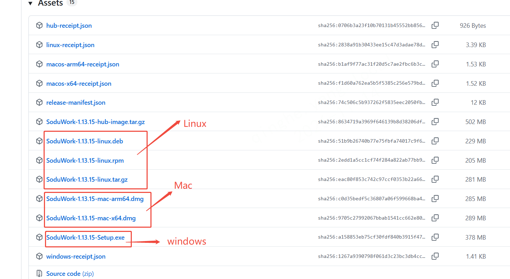

## 三、详细安装步骤

### Windows

1. **运行安装程序**：在浏览器的下载列表或“下载”文件夹中，双击已下载的 `.exe` 安装包。如系统弹出用户账户控制（UAC）提示，请点击 **是** 允许安装。
2. **选择安装语言**：在安装向导中选择界面语言，点击 **确定** 继续。
3. **选择安装范围与安装路径**：根据需要选择“仅为当前用户安装”或“为所有用户安装”，确认或自定义目标安装目录后点击 **下一步** / **安装**。
4. **完成安装并启动**：等待进度条完成，勾选 **运行 SoduWork**（或安装完成后从桌面快捷方式、开始菜单启动），点击 **完成**。

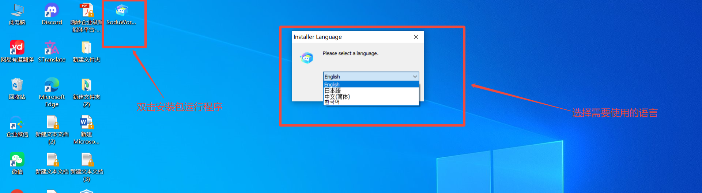

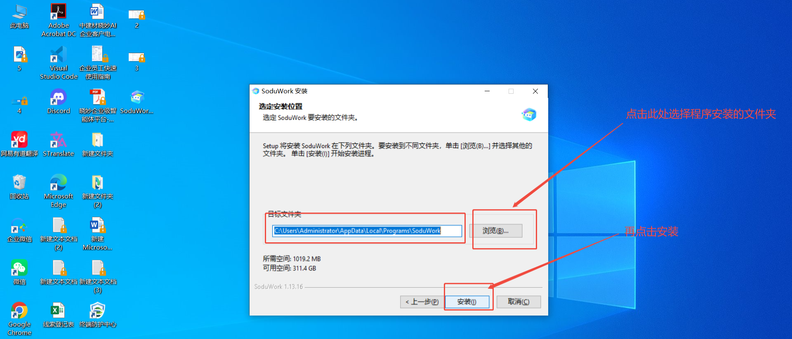

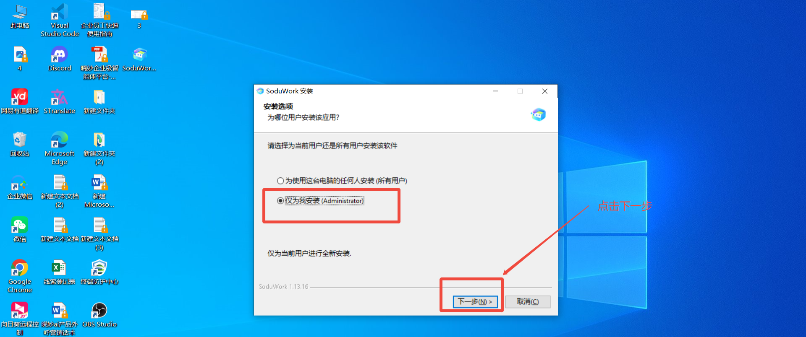

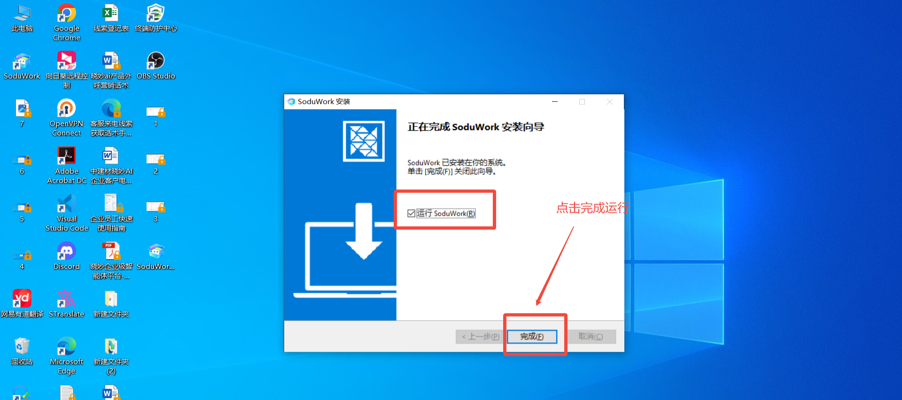

### Linux（Ubuntu / Debian）

1. **定位安装包路径**：打开终端，进入安装包所在目录（通常为 `~/Downloads`），查看实际下载的 `.deb` 文件名：
   ```bash
   cd ~/Downloads
   ls -lh SoduWork*.deb
   ```
2. **使用 `apt` 安装本地包**：执行以下命令进行安装（请将 `<实际文件名>.deb` 替换为上一步查看到的完整文件名，使用 `./` 前缀可确保 `apt` 识别为本地文件并自动解析系统依赖）：
   ```bash
   sudo apt update
   sudo apt install ./<实际文件名>.deb
   ```
3. **启动客户端**：安装完成后，可在系统应用菜单中搜索 **SoduWork** 启动，或在终端直接输入 `soduwork` 运行。

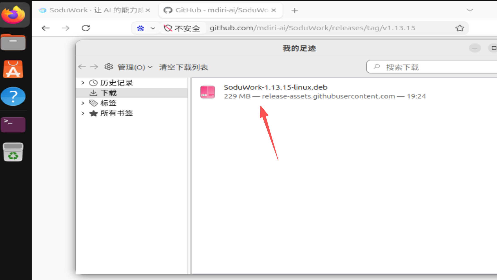

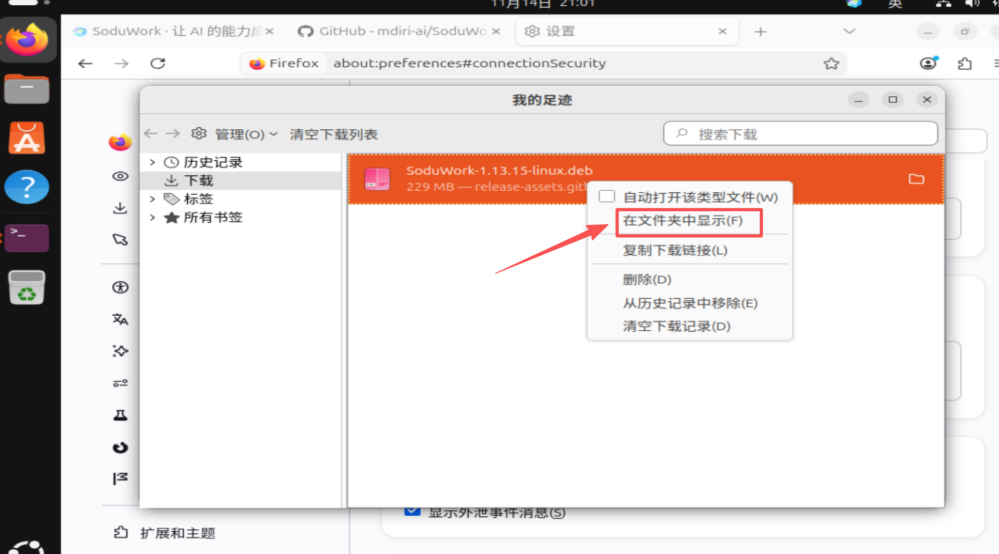

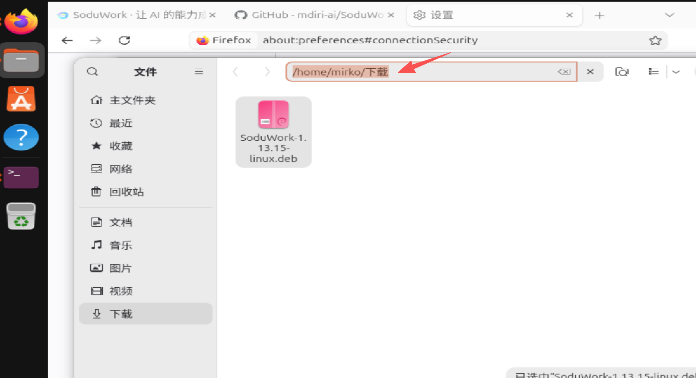

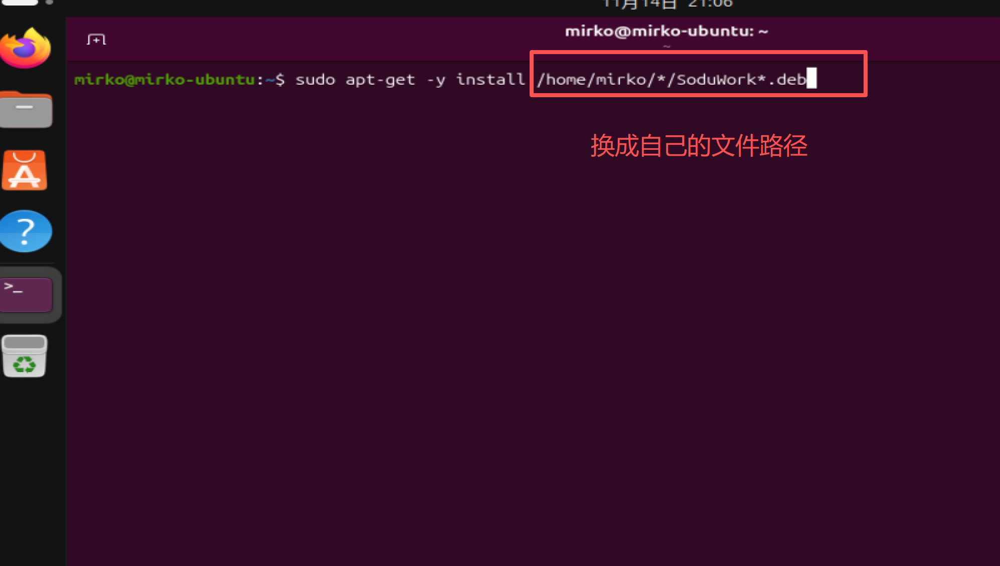

### macOS

在“下载（Downloads）”文件夹中找到下载好的 `.dmg` 安装包（例如 `SoduWork-<version>-mac-arm64.dmg`），按以下 3 步完成安装：

1. **打开镜像文件**：双击下载好的 `.dmg` 文件，等待系统校验并弹出安装窗口。
2. **拖入应用程序**：在弹出的窗口中，用鼠标按住 `SoduWork` 图标，拖拽到右侧的 **Applications（应用程序）** 文件夹中。
3. **从应用程序启动**：打开 **访达（Finder） → 应用程序（Applications）**，双击 **SoduWork** 启动客户端。如首次打开遇到系统安全提示，请参考文末“常见问题排查”中的 macOS 说明处理。

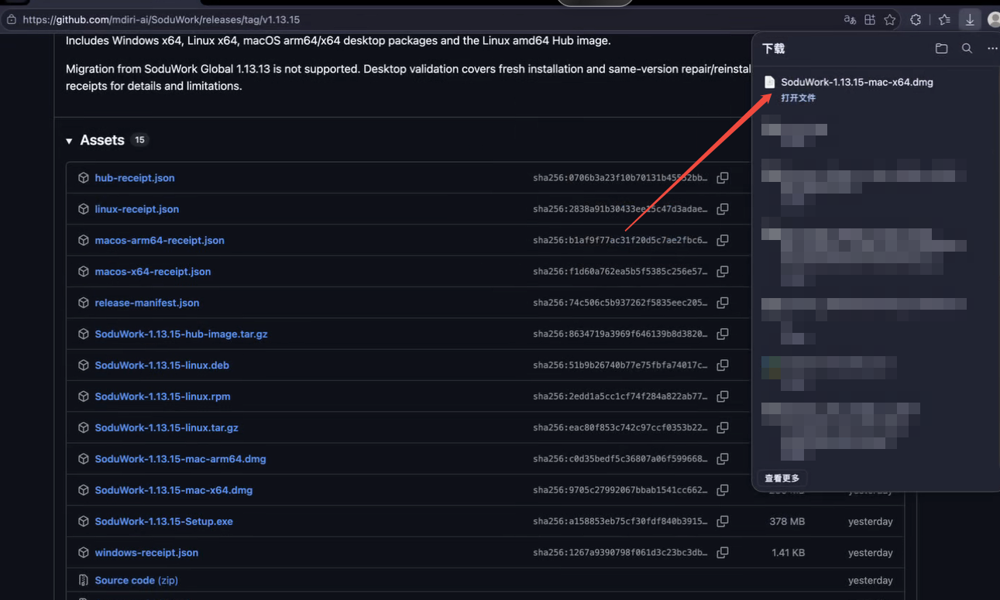

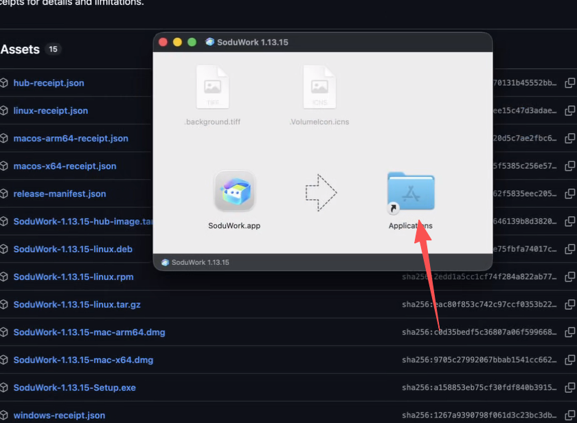

## 四、登录并开始首次对话

1. **切换界面语言与检查服务连接地址**：
    - 如需切换显示语言，可在登录页底部将界面语言切换为所需语言。
    - 在登录或注册前，请核对页面上的 **服务连接地址**：使用公共服务请确认地址为 `https://service.soduwork.ai`；使用企业自建服务请填写管理员提供的 Hub 地址。
2. **注册或登录账号**：
    - 已有账号可直接输入邮箱与密码登录。
    - 首次使用请点击左下角 **创建账号**，输入邮箱并点击获取 **验证码**，填入邮箱收到的验证码后按页面要求设置密码（默认 8–128 个字符）并确认，勾选 **用户协议** 和 **隐私政策** 后提交注册。

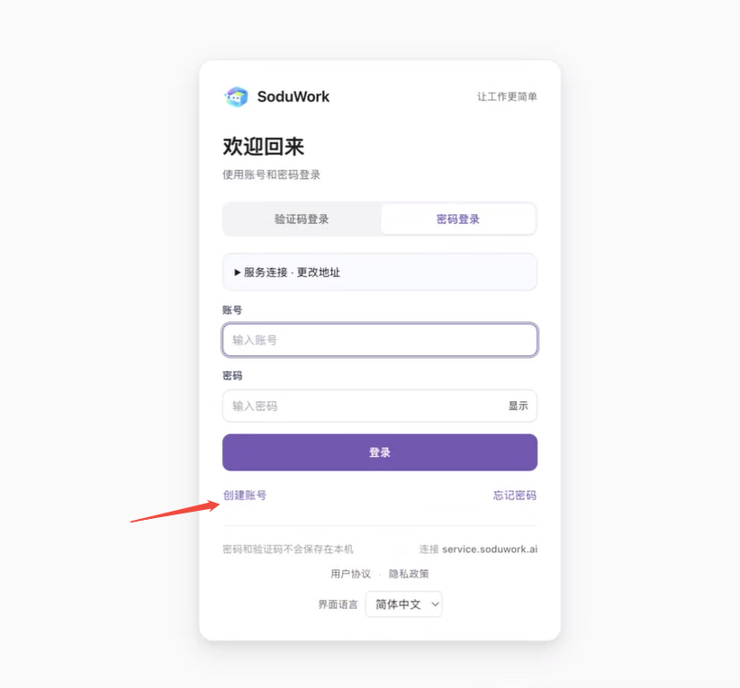

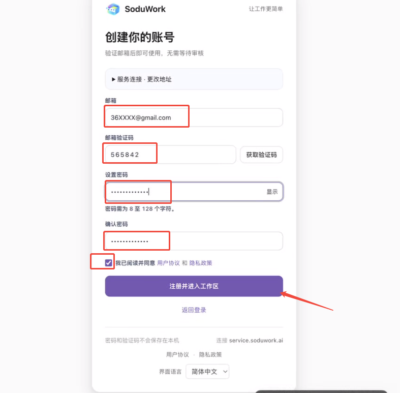

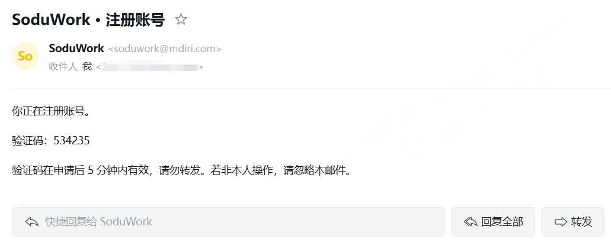

3. **进入工作台并发起首次对话**：
    - 登录成功后将进入工作台界面。
    - 点击 **新建对话**，在对话设置中选择当前可用的 **Agent** 和 **模型**。
    - 在输入框发送一条测试消息，例如：`把以下虚构会议记录整理为待办事项：周三前由小王完成接口联调，周五前由小李输出测试报告。`
    - 收到模型正常回复后，说明客户端与后端服务已全部连通。若发现 Agent 或模型列表为空，请检查当前连接的服务地址是否正确，或联系对应环境的管理员确认权限与模型配置。

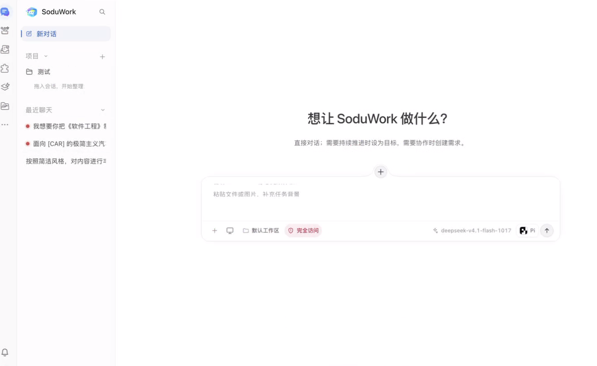

## 五、常见问题排查

### 1. macOS 提示“无法打开”或安全警告

- **确认来源**：首先确认安装包下载自官方 [GitHub Releases](https://github.com/mdiri-ai/SoduWork/releases/latest) 页面，切勿运行来历不明的安装包。
- **允许运行**：如系统提示“无法打开，因为 Apple 无法检查其是否包含恶意软件”或类似提示，可打开 **系统设置 → 隐私与安全性**，向下滚动找到被拦截的 `SoduWork` 提示并点击 **仍要打开**，随后输入管理员密码确认。
- **官方参考**：不同 macOS 版本的具体操作与安全策略，请参阅 [Apple 官方支持文档：在 Mac 上安全地打开 App](https://support.apple.com/zh-cn/102445)。

### 2. Linux 安装 `.deb` 包失败

执行 `sudo apt install ./<实际文件名>.deb` 时若报错，请根据具体提示排查，切勿仅依赖 `apt update`（该命令仅刷新软件源索引，不会自动修复依赖）：

- **提示缺少依赖（Unmet dependencies）**：运行 `sudo apt --fix-broken install` 自动补齐缺失依赖后，重新执行 `sudo apt install ./<实际文件名>.deb`。
- **提示找不到文件或权限不足**：确认终端当前工作目录正确，且命令中包含了 `./`（如 `./SoduWork-<version>-linux.deb`）。
- **提示架构不匹配（package architecture does not match system）**：运行 `uname -m` 检查系统架构（`x86_64` 对应 `amd64`，`aarch64` 对应 `arm64`），仅在发布页提供对应架构时下载该安装包。
- **提示归档文件损坏（corrupted filesystem tarfile）**：安装包下载不完整，请删除旧文件后重新从 GitHub Releases 下载。
- **官方参考**：更多包管理操作请参阅 [Ubuntu 软件包管理文档](https://ubuntu.com/server/docs/how-to/software/package-management/)。

### 3. 下载缓慢或无法连接服务

- **区分故障阶段**：
    - **GitHub 下载失败**：属于本地网络访问 GitHub 异常。
    - **DNS 解析失败 / 服务连接超时**：先核对客户端填写的服务地址（`https://service.soduwork.ai` 或企业 Hub 地址）拼写与协议头（`http://` 或 `https://`）是否准确。
- **配置代理的注意事项**：仅在您所在网络环境确实需要通过代理访问外网、且已从网络管理员处获得有效的代理服务器 IP 与端口时，才在系统网络设置中启用手动代理。注意：仅修改浏览器插件代理通常不会作用于桌面客户端，需在系统级网络设置中配置代理或开启全局/TUN 模式。

以下截图展示 Firefox 的代理设置，仅影响浏览器下载，不会修改桌面客户端的代理设置。

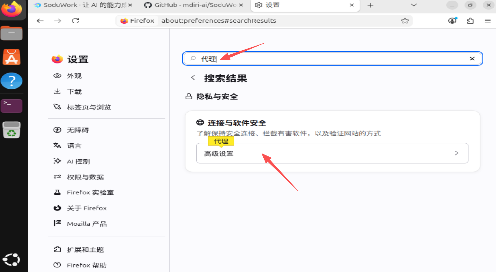

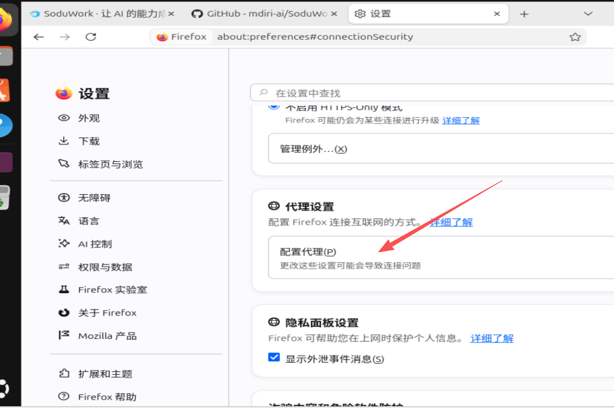

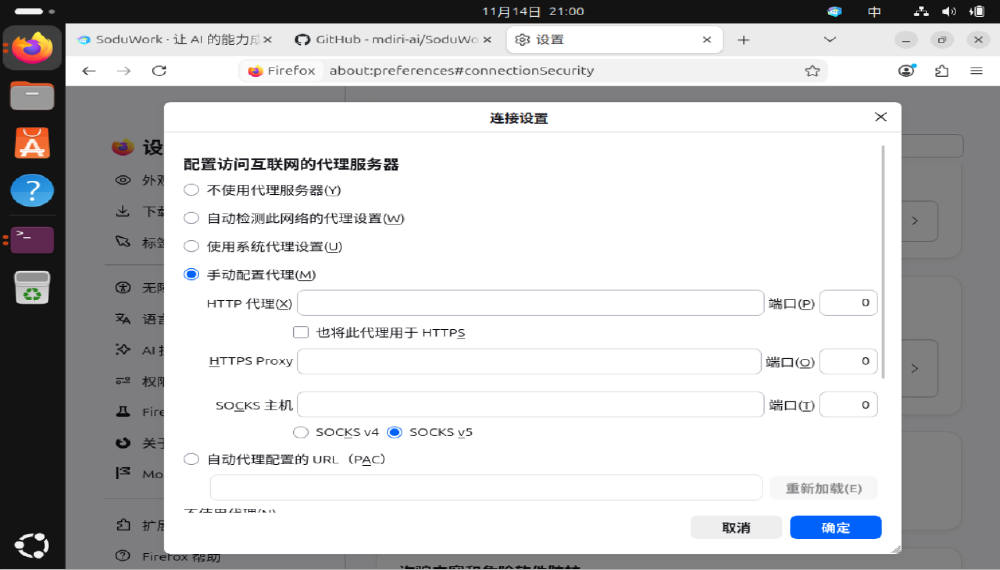
